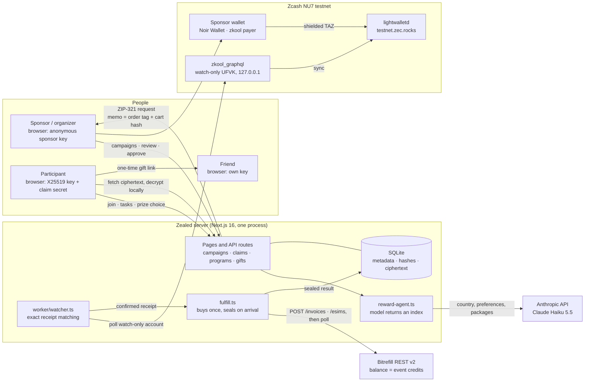
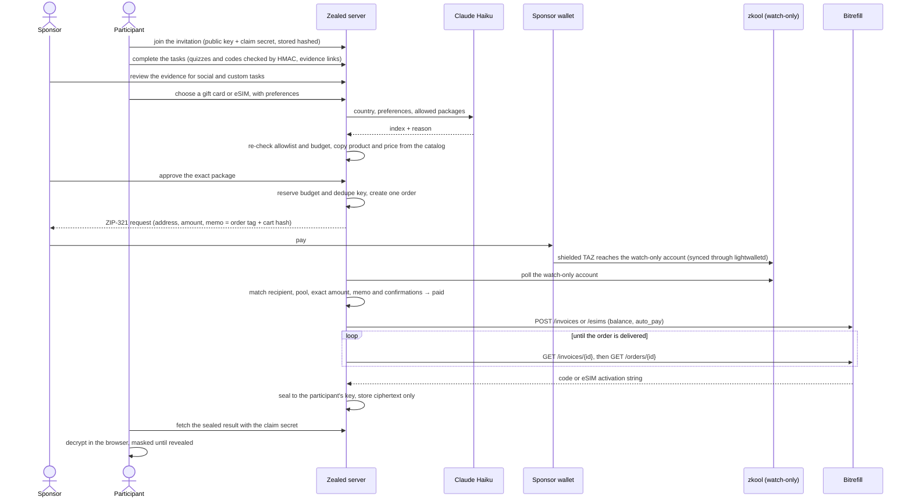
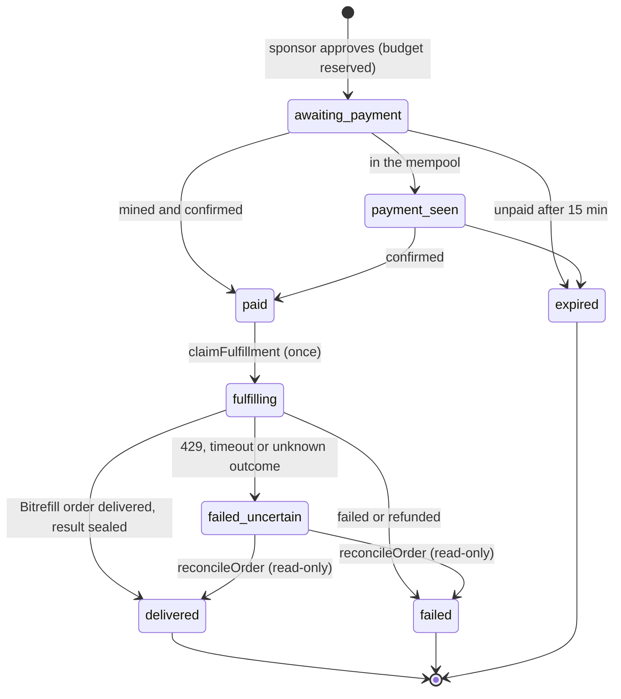
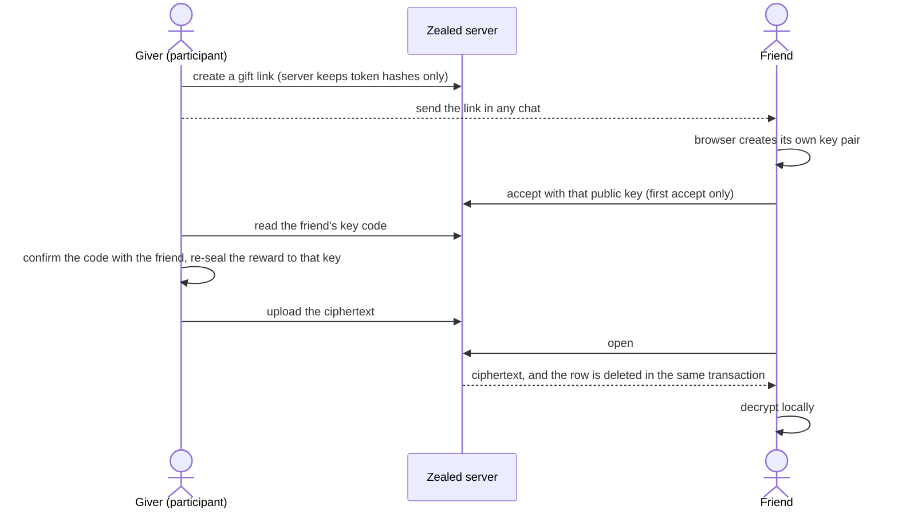

<!--
DRAFT. Before submitting:
- Replace every "TODO" (grep -n TODO README.md).
- Delete all HTML comments, this one included.
- Keep the pitch identical to the one on the Stadium form.
- Flip each 🟡 row in "What actually works" to ✅ only once you have evidence for it.
-->

<div align="center">

# Zealed

**Complete an event’s missions, unlock one prize, and receive a gift card, eSIM, testnet Zcash or custom reward—with codes sealed to your browser.**

Organizers build a checklist of event missions and fund the prizes. An AI agent picks a perk the participant can actually use, the sponsor authorises that exact purchase with a shielded Zcash payment, and Bitrefill delivers it. The code is sealed to the participant's browser key the moment it arrives, so Zealed's database, logs and AI never hold it in readable form.

[](https://z.cash)
[-2b2b2b)](https://zips.z.cash/)
[](https://docs.bitrefill.com)
[](https://nextjs.org)
[](https://libsodium.org)
[](https://www.anthropic.com)
[](#testing)
[](https://github.com/r0bops/zealed/actions/workflows/ci.yml)
[](./LICENSE)

[Live app](https://tryzealed.xyz) · [Try it](#try-the-live-site) · [Evidence](#testnet-transaction-evidence) · [What works](#what-actually-works) · [Privacy and trust](#privacy-and-trust) · [Bitrefill](#agentic-commerce-with-bitrefill) · [Security model](#security-model)

Free Society Hack 2026 · Mumbai · Tracks: Privacy (Zcash) + Agentic Commerce (Bitrefill)

---

</div>

> **Testnet only.** Zealed is a hackathon prototype. Zcash payments use worthless testnet TAZ. On the public site, Bitrefill purchases run in **test mode**, so the codes can't be redeemed. It hasn't been audited and isn't a financial product.

| | |
|---|---|
| **Tracks** | Privacy (Zcash) **and** Agentic Commerce (Bitrefill) |
| **Privacy theme** | 1. Private payment rails (a payment matched to its order by an encrypted memo) |
| **Bitrefill lane** | 5, Private by default, with mission-triggered fulfillment and gift on claim |
| **What it is** | A web app for event mission rewards (organizer and participant sides), with an AI agent that picks the perk |
| **Live URL** | https://tryzealed.xyz (also https://www.tryzealed.xyz). Bitrefill purchases run in **test mode**. Sponsors start with **Start funding**, with no token needed |
| **Demo video** | TODO: https://… (2–3 minutes) |
| **Testnet txid** | `1843616532cee751cbe556e902723d47b6675b6c92300b24070b8b6d1961f9ca`: a sponsor's shielded payment authorising a mission reward, mined at height 4581978. [Explorer](https://testnet.zcashexplorer.app/transactions/1843616532cee751cbe556e902723d47b6675b6c92300b24070b8b6d1961f9ca). More in [the evidence](#testnet-transaction-evidence) |
| **Real purchase invoice ID** | None yet. Every purchase so far was one of Bitrefill's free test products (invoices below). A paid purchase needs event credits and `BITREFILL_PURCHASES=live` |
| **Bitrefill test-product invoices** | `7d8e4569-daa5-4de9-9a35-518b7d42c47f` (mission reward, eSIM) · `2cc79a30-29c6-423a-9d7a-8844d63b671a` (mission reward, gift card) · `306668d4-01cd-4294-a08c-a6e94641eb11` (attendee-checked reward, gift card) · `98d4f316-c3fa-482a-9137-91723064b4e5` (checkout gift card) · `3f51bca9-39bc-4579-bd51-6df1fc584d4b` (checkout eSIM). These are real API purchases of Bitrefill's free test products, and their codes can't be redeemed |
| **Team** | [@r0bops](https://github.com/r0bops) · [@Cbiux](https://github.com/Cbiux) |

## Table of contents

- [Overview](#overview)
  - [The problem](#the-problem)
  - [The user](#the-user)
  - [One-liner](#one-liner)
  - [What's different](#whats-different)
  - [Which parts serve which track](#which-parts-serve-which-track)
- [Core features](#core-features)
- [Architecture](#architecture)
- [How it works](#how-it-works)
  - [A mission reward, end to end](#a-mission-reward-end-to-end)
  - [Order lifecycle](#order-lifecycle)
  - [Passing a reward on with a sealed gift link](#passing-a-reward-on-with-a-sealed-gift-link)
  - [Other prize types](#other-prize-types)
- [Specs at a glance](#specs-at-a-glance)
- [Testnet transaction evidence](#testnet-transaction-evidence)
- [What actually works](#what-actually-works)
- [Quick start](#quick-start)
  - [Try the live site](#try-the-live-site)
  - [Run it yourself](#run-it-yourself)
  - [Real shielded payments](#real-shielded-payments)
- [Privacy and trust](#privacy-and-trust)
- [Agentic commerce with Bitrefill](#agentic-commerce-with-bitrefill)
- [Security model](#security-model)
- [Project structure](#project-structure)
- [API reference](#api-reference)
- [Environment variables](#environment-variables)
- [Technology stack](#technology-stack)
- [Deployment](#deployment)
- [Demo](#demo)
- [Built during the hack vs before](#built-during-the-hack-vs-before)
- [AI usage](#ai-usage)
- [Compliance by design](#compliance-by-design)
- [What's next (30 days)](#whats-next-30-days)
- [Team](#team)
- [Feedback](#feedback)
- [License](#license)
- [Resources used](#resources-used)

---

## Overview

### The problem

Event organizers hand out perks for showing up, learning something or helping the community. Today that usually means copying redemption codes into spreadsheets or messages. Whoever handles those copies can spend the codes. The organizer also has to guess which perk each person can use, such as an eSIM for their destination or a gift card valid in their country.

- **Problem hypothesis:** organizers need bounded reward distribution that doesn't copy codes around. Participants need perks they can actually redeem. This need hasn't been validated with an organizer yet.
- **Evidence:** none yet. We haven't validated this need with an organizer or with participants, and we don't claim any demand.

### The user

An event or community organizer who offers useful perks to participants who complete missions, together with the participants themselves. Participants don't give Zealed a name or an email address to claim a reward.

### One-liner

**Zealed turns event missions into private, agent-chosen rewards.** The organizer sets the tasks, the prize types and a budget. The participant completes every task and picks one prize. For a gift card or eSIM, the agent chooses the package, the sponsor approves it and authorises it with a shielded testnet payment, and Bitrefill delivers a code that only the participant's browser can open.

*Organizers set the rules, the server enforces them, and the agent only chooses inside them.*

### What's different

| | Zealed | Codes handed out by hand | A shopping chat assistant |
|---|---|---|---|
| **Who chooses the perk** | The agent, from the organizer's allowlist, using the participant's stated needs (purpose, trip length, device) | The organizer guesses | The buyer |
| **Who can read the code** | Only the participant's browser. It's sealed on arrival, and the fulfillment server holds it only briefly in memory | Whoever handles the spreadsheet or messages | The platform, its logs and the chat history |
| **Eligibility** | Server-checked quizzes and codes, organizer review of evidence, one claim per invitation, one reward per attendee | Trust | Not applicable |
| **Spending** | Per-campaign budget, daily cap, sponsor approval of the exact order, atomic budget reservations | Manual | Per purchase |
| **Payment authorization** | A shielded Zcash payment bound to the exact cart by its memo | None | A card or crypto checkout |
| **Passing a reward on** | A one-time sealed gift link, re-sealed to the friend's own browser key | Forward the code | Forward the code |

### Which parts serve which track

| Privacy (Zcash) | Agentic Commerce (Bitrefill) |
|---|---|
| ZIP-321 payment request with the order tag and cart hash in an encrypted memo | Reward agent that selects from allowed packages using structured preferences |
| Watch-only payment detection with a viewing key (zkool_graphql) | Guardrails: campaign allowlists, sponsor approval, atomic budget reservations |
| Exact receipt matching: recipient, shielded pool, amount, memo and confirmations | Automatic fulfillment through Bitrefill REST v2, polled until delivered |
| Reward codes and activation data sealed to the participant's browser key | Delivery the agent can't read: the result is sealed before it's stored |
| Pay from the browser with Noir Wallet; FROST 2-of-3 sponsor treasury run live | Mission-triggered purchases and one-time gift links (Lane 2, "gift on claim") |

---

## Core features

### Event mission checklists
Organizers build 1–10 required tasks from event templates or from blank tasks:
- venue check-in, sponsor-booth and talk codes
- quizzes
- social-media actions: follow on X, repost, join Telegram or Discord, star on GitHub, follow on LinkedIn or Farcaster
- custom tasks, such as submitting a project

Quiz answers and secret codes are checked on the server against HMACs, so the stored campaign never holds the answer or code. Social and custom tasks take public evidence links for the organizer to review, and social evidence must be on the chosen platform's domain. Requirements can't change after creation, and redemption stays locked until every task is approved.

### One prize, four kinds
The participant chooses exactly one prize, and the choice can't change afterwards:
- a **Bitrefill gift card or eSIM**, chosen by the agent and authorised by the sponsor
- a **direct shielded testnet payout** (TAZ) from the sponsor's wallet
- a **custom reward**, whose instructions the organizer encrypts in their browser to the participant's key

### Agent selection inside the rules
Claude Haiku 5.5 receives only the campaign's country, the participant's structured preferences and a bounded list of eligible packages. It returns an index and a short reason. The server re-checks the allowlist and budget and copies the product and price from the catalog, never from the model's text. The model has no tools, can't grant eligibility and never buys.

### Shielded payment authorization
Approving a gift card or eSIM creates one order and a ZIP-321 request whose memo carries the order tag and a hash of exactly what's being bought. A watch-only `zkool_graphql` account sees the payment and checks the recipient, shielded pool, exact amount, memo and confirmations. Bitrefill doesn't take ZEC, so the payment *authorises* the purchase, and Zealed pays Bitrefill from event credits within fixed caps.

### Sealed delivery
`lib/fulfill.ts` buys at most once, seals Bitrefill's response to the participant's X25519 key with `crypto_box_seal` as soon as it arrives, and stores only the ciphertext. The participant's browser decrypts it, keeps codes masked until revealed, and renders eSIM QR codes locally.

### Attendance without identity
In the attendee mission, the organizer imports their Luma guest list and Zealed keeps only hashes of approved guests' emails. The participant's browser hashes the email it's given, so the server never sees the address. A keyed nullifier allows one reward per attendee per event. The optional Reclaim zkTLS mission proves approved Luma attendance without the guest list. It ran live once, but it isn't enabled on the public site.

### Anonymous sponsors
**Start funding** gives a sponsor a random key that only their browser holds, and the server stores its SHA-256 hash. Each sponsor sees and manages only their own campaigns. Open sponsorship is capped and turns itself off when purchases go live.

### One-time sealed gift links
A participant can pass a delivered reward to a friend through any chat. The friend's browser creates its own key, the giver re-seals the reward to it in their own browser, and the server deletes the ciphertext on the first open.

### FROST 2-of-3 sponsor treasury
A shared treasury address whose spending needs two of three key shares (organizer, co-sponsor and Zealed). Key generation and one signed payment ran live on testnet. The web app doesn't use it yet.

---

## Architecture



### Components

| Component | Role | Code |
|---|---|---|
| Campaigns and claims | Hashed invitations, anonymous sponsor ownership, atomic single-use claims, mission checks | `lib/campaigns.ts`, `lib/program.ts`, `lib/program-schema.ts` |
| Reward agent | Bounded selection from eligible packages; the server copies the product and price from the catalog | `lib/reward-agent.ts` |
| Sponsor order | Approval creates exactly one order bound to the participant's key, with a ZIP-321 request | `lib/sponsor-order.ts`, `lib/cart.ts`, `lib/zip321.ts` |
| Guardrails and reservations | Spending caps, price drift of at most 5%, atomic spend reservations | `lib/guardrails.ts`, `lib/orders.ts` |
| Payment watcher | Watch-only detection and exact matching; reconciles uncertain purchases once a minute | `worker/watcher.ts`, `lib/zcash-zkool.ts`, `lib/zcash.ts` |
| Fulfillment | The only code that touches Bitrefill purchase responses: buys at most once, then seals | `lib/fulfill.ts`, `lib/bitrefill.ts` |
| Encryption | X25519 key pairs and sealed boxes; per-order keys in the browser (IndexedDB) | `lib/sodium.ts`, `lib/keystore.ts`, `lib/payload.ts` |
| Attendance | Email-hash allowlist, keyed nullifiers, the Reclaim zkTLS mission | `lib/attendees.ts`, `lib/attendee-hash.ts`, `lib/reclaim.ts` |
| Gift links | One-time re-sealed handover to a friend's key | `lib/gift-links.ts`, `lib/gift-envelope.ts` |
| FROST treasury | 2-of-3 key generation and signing over zkool's DKG and FROST operations | `lib/frost.ts`, `scripts/frost-setup.ts`, `scripts/frost-pay.ts` |
| Abuse limits and logging | Per-client rate limits, metadata allowlist, secret redaction | `lib/rate-limit.ts`, `lib/event-metadata.ts`, `lib/log.ts` |

### Trust boundaries

| Boundary | Trust level | What enforces it |
|---|---|---|
| LLM → anything | Untrusted | It returns only an index and a reason, and it has no tools. The server re-checks the allowlist and budget and copies the product and price from the catalog. The model can't grant eligibility, approve or buy |
| Participant browser → server | Untrusted input | Schema validation, per-client rate limits, HMAC-checked answers and codes, at most five attempts, an atomic single claim, and a claim secret required to read results |
| Sponsor browser → server | Authenticated | A sponsor key (stored as a hash) or the operator token. Each campaign is scoped to its owner, and other sponsors get 404. Open access is capped and fails closed when purchases are live |
| Payment → order | Untrusted until matched | The exact recipient, a shielded pool, the exact amount, the memo tag, the cart hash and the confirmation count. Each txid matches one order only |
| Server → Bitrefill | Trusted API, real money in live mode | A dedupe key reserved before `POST /invoices`, caps, re-pricing with at most 5% drift, read-only reconciliation |
| Bitrefill response → storage | Plaintext secret | Sealed in `lib/fulfill.ts` on arrival. Only ciphertext is stored, and responses are never logged |
| Server → participant's browser | Trusted to serve honest JavaScript | A known limit: a malicious server could serve code that swaps keys. Verified client builds are on the roadmap |

---

## How it works

### A mission reward, end to end



In the real runs, the time from sending the payment to delivery was 71–76 seconds.

### Order lifecycle



`expired`, `delivered` and `failed` are terminal. The sponsor can approve the reward again only after its order expired **without** a payment, using a new dedupe key, so a reward can never be bought twice. With zkool, the mempool state doesn't appear, so orders go straight from awaiting payment to paid.

### Passing a reward on with a sealed gift link



The server stores hashes of three tokens (the link, the giver's token and the accepting browser's token), the friend's public key and the ciphertext. It keeps no order, wallet, txid or link to the giver. Unopened gifts are deleted after `GIFT_TTL_HOURS` (72 by default).

### Other prize types

- **Direct Zcash prize:** the participant supplies a testnet unified address. The organizer approves a send in Noir Wallet, and Zealed records the returned transaction ID automatically; other wallets can still enter it by hand. An unrecorded Noir broadcast is saved in this tab's session storage, so recording can be retried without sending again. Address validation checks the format only, not the receiver or checksum. Zealed doesn't verify the destination, amount or confirmations of these payouts. The participant checks their wallet and acknowledges receipt separately.
- **Custom reward:** the organizer encrypts the instructions in their browser to the participant's public key, and the server stores only the ciphertext. The participant decrypts it locally and acknowledges receipt. That's not proof of physical delivery, and the organizer necessarily knows the instructions they issue.
- **Quick demo setup:** new campaigns start with gift card, eSIM and 0.01 TAZ prize options. Gift cards use Flipkart India and eSIMs use Bitrefill eSIM India, and availability and prices are still checked on the server. Keep a $5 Bitrefill budget, confirm the displayed restrictions and create the invitation without browsing the catalog; advanced options keep custom product and country selection. Participants reserve a gift card or eSIM and request the agent's choice in one step. If that fails, the reserved prize stays and the selection can be retried.
- **Legacy invitations:** campaigns without a task checklist keep their fixed quiz, the email-list attendance check (`MISSION_MODE=email`) or the optional Reclaim mission. These global modes don't apply to new checklist campaigns.

---

## Specs at a glance

| Spec | Value |
|---|---|
| Network | Zcash NU7 testnet (TAZ, worthless). New shielded funds go to the Ironwood pool |
| Addresses | Unified `utest1…` addresses with an Ironwood or Sapling receiver |
| Light-wallet server | `testnet.zec.rocks:443` |
| Payment watcher | zkool2 `zkool_graphql` v6.36.0, watch-only UFVK account (birth height 4581688), bound to 127.0.0.1 |
| Confirmation threshold | 1 block (`ZCASH_MIN_CONFIRMATIONS=1`) |
| Payment request | ZIP-321; the memo is the order tag + cart hash; expires after 15 minutes |
| Encryption | libsodium X25519 + `crypto_box_seal`; one key pair per order, kept in the browser (IndexedDB) |
| Agent | Claude Haiku 5.5 (`claude-haiku-5-5`) through AI SDK 7; no tools; at most 3 selection attempts per claim; 45 s timeout |
| Campaign | 1–10 tasks, one invitation, one participant, 24-hour expiry, at most 5 submissions per task |
| Spending caps | Up to $20 per campaign ($5 for open sponsors); $25 of agent orders a day in total; Bitrefill's own 5 top-ups and 15 gift cards a day; price drift of at most 5% |
| Open sponsors | $5 per campaign, 5 campaigns a day per sponsor key, 300 new sponsor sessions a day site-wide; off when purchases are live |
| Rate limits (per client per minute) | Claim 10, agent selection 6, Reclaim request 10, approval 20, campaign creation 20, campaign list 60, Start funding 5, invitation 60, order status 120, program action 20, organizer review or delivery 30 |
| Gift links | One accept, one open; unopened links deleted after 72 hours (configurable, up to 720) |
| Direct Zcash prize | Testnet only, at most 1 TAZ |
| Bitrefill | REST v2, `payment_method: "balance"`, `auto_pay: true`; purchase modes `simulate`, `test` and `live` |
| Tests | 153 in 21 files (4 Nov 2026) |

---

## Testnet transaction evidence

Every txid below is a shielded transaction on the public NU7 testnet, viewable at `https://testnet.zcashexplorer.app/transactions/<txid>`. Each run is listed separately; they aren't one continuous story. All Bitrefill purchases here were of Bitrefill's free **test products**.

**Mission rewards (4 Nov 2026)**

| Run | What it shows | Txid | Bitrefill invoice |
|---|---|---|---|
| eSIM reward | Campaign `b9761ef5` ($5, India). Claude Haiku chose the India eSIM, 1 GB for 7 days at $3.89. The sponsor paid 0.12967367 TAZ (height 4581978), and the order was delivered 71 s after sending. The participant decrypted the eSIM activation string locally | [`18436165…f9ca`](https://testnet.zcashexplorer.app/transactions/1843616532cee751cbe556e902723d47b6675b6c92300b24070b8b6d1961f9ca) | `7d8e4569-daa5-4de9-9a35-518b7d42c47f` |
| Gift card reward | Campaign `e8f9427e`. The agent chose Flipkart ₹50 ($0.56). Height 4582006; decrypted by the participant | [`89eff39b…f114`](https://testnet.zcashexplorer.app/transactions/89eff39bc9db8418d51eea75c9cfb3bb9462b1e0138ea687a017e3f4fe41f114) | `2cc79a30-29c6-423a-9d7a-8844d63b671a` |
| Attendee-checked reward | Campaign `eab0e7a0`, fictional demo list. Only the browser-made hash of `bob@example.org` was sent, and the participant appeared as "Attendee EBAF-F4BD". Flipkart ₹50, 0.01867583 TAZ (height 4582200), decrypted 76 s after sending. The same email on a new campaign got 409, and a scan of every database table found no email address | [`f1fa38e3…631b`](https://testnet.zcashexplorer.app/transactions/f1fa38e3bd4f2b7ce6225aa1911051c94652d7fab770ecbdddbb260f3d60631b) | `306668d4-01cd-4294-a08c-a6e94641eb11` |
| Re-run after adding Reclaim and FROST | Quiz mission; order `7c900ffa`, height 4582062; test card decrypted | [`31aa5601…b601`](https://testnet.zcashexplorer.app/transactions/31aa5601fcdcb2b0154219c405b65b85a5070c09790fc1afcfa3c3d03e2ab601) | not recorded |

**FROST 2-of-3 sponsor treasury (4 Nov 2026, three separate zkool wallets)**

| Step | What it shows | Txid |
|---|---|---|
| Key generation | DKG over shielded memos in 4 min 14 s (heights 4582543–4582552). The shared treasury `utest1ymcdzc…zrkcs6` receives in the Ironwood pool | no single txid (three protocol memos per participant) |
| Fund the treasury | 0.02 TAZ to the shared address, height 4582558 | [`65ddf619…1b58`](https://testnet.zcashexplorer.app/transactions/65ddf619d3836a4597825044ce1f3029bc2f6a56d4be2e14429568748bad1b58) |
| 2-of-3 payment | Participants 1 and 2 signed 0.001 TAZ while participant 3 stayed offline. Signing took 4 min 38 s, and the payment was mined at height 4582571 | [`bb88e3f4…28ab`](https://testnet.zcashexplorer.app/transactions/bb88e3f44c5c3f3959280ea80074ce3bfc17b53fc739079598103fdcdaec28ab) |

**Reclaim zkTLS attendance proof (4 Nov 2026, 16:18 UTC, separate instance in Reclaim mode)**

An approved guest of the Free Society Hackathon signed in to Luma inside Reclaim's verification flow. The server verified the proof against our custom provider `10103ed6-3256-4a96-a2ae-d5230df0a649`, version 1.0.2 (event `evt-B6kmWqZYUUeTkIP`, status approved), and accepted claim `8e605d1a` on campaign `a0dba462`. It stored exactly one attendance nullifier and no email or name. There's no payment in this run.

**Earlier checkout flow (4 Nov 2026, since removed)**

The first version of Zealed was a shopping chat with per-order checkout. It has been removed, but its runs used the same payment, watcher and fulfillment code.

| Run | Txid | Bitrefill invoice |
|---|---|---|
| First shielded order payment (0.12966881 TAZ, height 4581712, about 60 s to mine; simulated fulfillment) | [`1bb9548e…defd`](https://testnet.zcashexplorer.app/transactions/1bb9548ea9ee04da491071e86f7287391aa52f3260c51ce6219324615768defd) | none |
| Test gift card, order `6c279e24` (height 4581762) | [`7bc881c3…8334`](https://testnet.zcashexplorer.app/transactions/7bc881c3cce15e0f5b24256f0c0de4a517c752760187f07faf210fcd07be8334) | `98d4f316-c3fa-482a-9137-91723064b4e5` |
| Test eSIM through `POST /esims`, order `49efc554` (height 4581766) | [`a352f788…58ed`](https://testnet.zcashexplorer.app/transactions/a352f788e27c073937b31ff40de810bcd27a434a2af5f067bc9df605062158ed) | `3f51bca9-39bc-4579-bd51-6df1fc584d4b` |

**Viewing key:** the demo receiving wallet's unified full viewing key, birth height **4581688**. Import it into a testnet wallet as watch-only to see the amounts and memos of the payments above. It reveals that wallet's history but can't spend from it.

```
uviewtest15n2vh4nwp9c875gv3efk63nqacsevqjakae5wytk9g2kndxpgx5z4sx5yqtr8urcthkn4cj59n9raz7y0dlc5gl0m7ymxzaq79qaasm0fgyjhw2d7jv77sz4numgsvwz45rvusn98nvq52cjnpt8qzl5nug6hxkl74fzjfy45q6d53tvqucwqr3j0kk99s0l4axwpv7kqrmycvlt39eue2cyc2a8evgzsvh4pwtj35am7nkku9mjewwqr2p5dwvr708mfpdrmkfa8z0ka6943g9psu9ak26e3vnr7qx6sl0029mav0tf3hslaf86440y7kjh024ymc35cumv0zkscuj75pe5qsesjl5ryp83nst7p77g9kxrxrreppdfm0w77ju09svx7uwc0uzpl99l9hvsqrpra2ckkrfepdtmq9wulq0fpy29n6yd0wvs7fc7z9zpe07ypm2d5va25h7pu04dx85aj2lefgpdtd54x45mt42xugmhzyye
```

---

## What actually works

| Step in the core flow | Status | Evidence |
|---|---|---|
| Mission rewards end to end: campaign, mission, claim, agent selection, sponsor approval, shielded payment, Bitrefill purchase, participant decryption | ✅ real on NU7 testnet, with Bitrefill **test products** | The eSIM and gift card runs in [the evidence](#testnet-transaction-evidence). Script: `scripts/e2e-rewards.ts` (`pnpm e2e:rewards`) |
| Agent selects from allowed catalog packages within the campaign budget | ✅ real | The same runs |
| Guardrails and authenticated sponsor approval | ✅ implemented and tested | `lib/guardrails.ts`, `lib/sponsor-order.ts`, `lib/safety.test.ts` |
| ZIP-321 request with the order tag and cart hash in the memo | ✅ real | `lib/zip321.ts`, `lib/cart.ts` |
| Shielded payment from a wallet (CLI payer through `pnpm zkool:pay`) | ✅ real | The txids above |
| Watch-only detection and confirmation through zkool_graphql | ✅ real | The watch-only account (UFVK, birth 4581688) matched the memo tag, cart hash, exact amount and recipient, then marked the order paid after 1 confirmation |
| Bitrefill purchase triggered by the confirmed payment, polled until delivered | ✅ real API purchases of Bitrefill **test products** (`BITREFILL_PURCHASES=test`) | Five invoices, gift cards and eSIMs |
| Result sealed to the participant's key and decrypted locally | ✅ real | Gift card codes and a real eSIM activation string, with its QR code rendered in the browser. `lib/keystore.ts`, `app/order-details.tsx` |
| Attendee check against the organizer's imported Luma guest list | ✅ real, with a Bitrefill **test product** | `lib/attendees.ts`, `lib/attendee-hash.ts`, `app/claim/email-verify.tsx`, `scripts/attendees-import.ts`, `lib/attendees.test.ts`. Live on the public site |
| One reward per approved attendee, without storing who they are | ✅ email-list variant live on the public site; Reclaim variant run live once | The nullifier is a keyed HMAC of the event ID and a per-guest value (the email hash, or the ticket key from a Reclaim proof), kept in `attendance_nullifiers`, unique per event, and written in the same transaction as the claim |
| Mission proved with a Reclaim zkTLS proof | ✅ one live proof, on a separate instance in Reclaim mode; inactive on the public site | `lib/reclaim.ts`, `app/claim/reclaim-verify.tsx`, `lib/reclaim.test.ts`. The proof is bound to the claim by a hash of the campaign and the participant's key, then checked with Reclaim's `verifyProof` plus provider and freshness checks. Only `{verified, providerId}` is kept |
| FROST 2-of-3 sponsor treasury | ✅ real on NU7 testnet (one key generation, one 2-of-3 payment). The web app doesn't use it yet; sponsors pay from their own wallets | `lib/frost.ts`, `pnpm frost:setup`, `pnpm frost:pay` |
| Checklist tasks: quizzes, venue, booth and talk codes, reviewed social and custom tasks, one-prize redemption | ✅ local browser flow and automated checks | `lib/program.test.ts`: all-task gating, authorization, attempt limits, reward locking, expiry, code matching without a stored plaintext code, and platform-domain checks on social evidence. The browser flow used real local routes and a temporary database, with no external purchase. No full checklist campaign has run on the live site yet |
| Custom reward instructions sealed by the organizer and opened by the participant | ✅ local browser flow | Create → join → quiz → evidence → review → reserve → seal → decrypt → acknowledge → reload, using synthetic instructions. No physical delivery is claimed |
| Sponsor access with **Start funding** instead of a token | ✅ implemented, tested and deployed (test purchases only) | `lib/campaigns.ts`, `app/api/sponsors/route.ts`, `lib/sponsors.test.ts`, `lib/sponsors-security.test.ts` |
| Rate limiting on public reward mutations | ✅ implemented and tested | `lib/rate-limit.ts`, `lib/rate-limit.test.ts` |
| Public deployment | ✅ live at https://tryzealed.xyz, Bitrefill test mode | A read-only smoke test passed: pages load, unauthenticated campaign listing gets 401, unknown campaigns and orders get 404, and the rate limit answers 429 with `Retry-After`. `GET /api/health` reports the deployed revision, watcher ticks and zkool sync lag |
| Direct Zcash prize | 🟡 built; no live payout recorded | Wallet-send UI, format-only address checks, a unique reported txid and separate participant acknowledgment. No destination, amount or confirmation checks |
| Shielded payment from the browser with Noir Wallet | 🟡 built; not yet recorded on testnet | No browser-wallet txid recorded yet. Organizer payouts with Noir save the returned txid automatically |
| One-time sealed gift links | 🟡 built, tested, linked from delivered rewards and deployed; no live gift opened yet | `lib/gift-links.ts`, `lib/gift-envelope.ts`, `app/api/gifts/`, `app/gift/`, `lib/gift-links.test.ts`. Tests cover a single open, first-accept-only, wrong tokens and roles, sealing only to the accepted key, cancel, expiry and the creation rate limit. An end-to-end test checks that the plaintext never reaches the database |
| Paid Bitrefill purchase of a real product | 🟡 not yet. It needs event credits and `BITREFILL_PURCHASES=live` | No paid invoice yet |

<a id="testing"></a>**Testing.** 153 automated tests pass across 21 files (`pnpm test`). Coverage includes spending and payment boundaries, legacy attendance, all-task gating, organizer review, rejected submissions, immutable prize choice, encrypted custom delivery, payout recording, expiry, sponsor isolation, catalog search and one-time gift links. CI runs install, typecheck, lint and the tests on every push and pull request. TypeScript, lint and the production build pass. Landing, organizer, participant, invitation, history and order pages were checked at 320, 375, 768 and 1440 px without horizontal overflow. No external purchase or payout happened during these checks.

**Known limitations:**
- Social and custom tasks need a human to review public links. The server only checks that social evidence is on the chosen platform's domain; there's no social-platform API or account-ownership check. A secret code proves only that the participant learned it, and anyone it's passed to can use it. Public links may reveal identity.
- Direct Zcash prizes are testnet only, at most 1 TAZ, and recording them is manual and unverified. Custom rewards use encrypted instructions and participant acknowledgment, not shipment tracking.
- Each campaign allows one claim, and none of the missions proves unique humanity. The quiz doesn't prove attendance. The attendee check proves that an email is on the organizer's list, not that the participant owns it, which is what the Reclaim mission adds. Anyone who already has candidate emails can guess the hashes.
- All Bitrefill purchases so far were free test products. A paid purchase of a real product is still to come.
- Rate limits live in one server process's memory, so they reset when it restarts.
- The $25 daily spend cap is global, not per sponsor, so one open sponsor could use up the day's test budget for everyone. That's a denial of service, not a loss of funds, because open access is off when purchases are live.
- Sponsor keys don't expire and sit in localStorage, so an XSS bug would expose them. Clearing site data loses access to that sponsor's campaigns; the operator token still sees them.
- Cross-device claim recovery isn't built. A backup of the decryption key alone doesn't restore the separate claim secret.
- A sealed gift link can't revoke the giver's own copy of the code. Deleted gift ciphertext may linger in SQLite free pages or the WAL until it's overwritten.
- The payment memo binds one exact order and recipient key, so one campaign deposit can't authorise arbitrary future claims. The watcher can't sign refunds, and pooled funding needs a separate design.
- A `fake` Zcash backend exists for local development only. It's labelled SIMULATED in the UI, it's refused in production, and it's never used in the demo.
- Bitrefill delivery is detected by polling, not webhooks.
- ZEC is priced at a fixed demo rate (`ZEC_USD_RATE`), because TAZ has no market price. BTC/USD is fetched live, with a configured fallback.
- The app and the watcher share one process and one SQLite file.

---

## Quick start

### Try the live site

Bitrefill purchases on https://tryzealed.xyz run in test mode: real API calls for Bitrefill's test products, whose codes can't be redeemed.

1. Open https://tryzealed.xyz, choose **Fund a reward** and click **Start funding**. Your browser creates an anonymous sponsor key, with no sign-up. Clearing this site's data loses access to your campaigns.
2. Create a campaign: tasks, prize types and, for gift cards or eSIMs, a budget of up to $5 and the allowed products. Open sponsors can create 5 campaigns a day.
3. Share the invitation link, or show its QR code full screen. On another device or browser, open it, or choose **Claim a reward** and scan or paste it at `/claim`.
4. Complete the tasks as the participant, then review them on the sponsor side. When every task passes, the participant picks one prize.
5. A gift card or eSIM needs the sponsor to approve the exact package and pay the shielded testnet request from an NU7 testnet wallet. The participant's browser then decrypts the delivered test code.

### Run it yourself

```bash
git clone https://github.com/r0bops/zealed
cd zealed
pnpm install
cp .env.example .env.local
pnpm keygen               # prints FULFILL_SECRET_KEY: paste it into .env.local
# .env.local:
#   ANTHROPIC_API_KEY     your Anthropic API key
#   BITREFILL_API_KEY     from https://www.bitrefill.com/account/developers (empty = SIMULATED catalog)
#   BITREFILL_PURCHASES   simulate (default) | test | live
#   ZCASH_BACKEND         zkool for real payments (fake = local development only, shown as SIMULATED)
#   SPONSOR_OPEN_ACCESS   1 to show "Start funding" (test or simulate mode only)
pnpm dev                  # http://localhost:3000
```

**How sponsors get in:**
- **Open sponsors:** `SPONSOR_OPEN_ACCESS=1` shows **Start funding** on `/campaigns`, and only while `BITREFILL_PURCHASES` isn't `live`. Optional caps: `OPEN_SPONSOR_MAX_CENTS` (default 500, so $5 per campaign), `OPEN_SPONSOR_CAMPAIGNS_PER_DAY` (5) and `OPEN_SPONSOR_SESSIONS_PER_DAY` (300 site-wide).
- **Operator override:** `CAMPAIGN_ADMIN_TOKEN`, a random secret of at least 32 characters, sees every campaign. It's required when open access is off. Keep it out of Git, and share it only with a trusted organizer. It's held in browser memory after login, never put in a URL.

**Running a campaign:**
1. Open `/campaigns`, click **Start funding** (or unlock with the operator token), add missions from the event templates or as blank quiz, code, social and custom tasks, and choose the prize types. For gift cards and eSIMs, allow 1–5 catalog products, check the issuers' restrictions and set a budget of up to $20 ($5 for open sponsors). Quiz checks need `FULFILL_SECRET_KEY` or an explicit `TOOL_APPROVAL_SECRET` on the server.
2. Create the one-use invitation and save its link straight away: the server stores only its hash. The secret travels in the URL fragment, is stored locally by the participant and is removed from the address bar. Anyone holding the link can reserve the claim.
3. On a separate browser or device, join, answer the quizzes and submit public evidence. Use **Review tasks & fulfill prize** in the organizer workspace to approve or reject it. When every task passes, the participant reserves a prize.
4. For Bitrefill, the participant asks the agent to pick a package, and the organizer approves and pays the exact shielded request, with **Open payment in wallet** (a ZIP-321 link) or `pnpm zkool:pay '<that link>'`. For custom rewards, the organizer uses **Seal & send instructions**. For Zcash, send once from the organizer's wallet and record the txid.
5. Back in the participant's browser, open the delivery and, for direct or custom rewards, acknowledge receipt. `/claim` resumes saved invitations, and `/orders` lists Bitrefill orders. Keys and claim access persist in IndexedDB.

**Attendee mission (legacy invitations):** set `MISSION_MODE=email` and `LUMA_EVENT_ID`, then import the guest list with `npx tsx --env-file=.env.local scripts/attendees-import.ts <luma-guests.csv>`. It keeps approved guests only and stores hashes, never emails. To try it without a real list, import `demo/luma-guests-demo.csv` (fictional `example.org` guests) and claim as `judge@example.org`. `carol@example.org` is pending and `dave@example.org` is declined, so both are refused.

**Purchase modes and recovery:**
- **simulate** is the default when `BITREFILL_PURCHASES` is unset or there's no Bitrefill API key, and its results are labelled SIMULATED. **test** buys Bitrefill's free test products. **live** buys real products from event credits. The organizer screen shows both the catalog mode and the purchase mode.
- An approved order expires 15 minutes later if it isn't paid, and then the sponsor can approve the reward again. An expired order that already saw a payment stays bound.
- Prices are re-checked at approval and at purchase. They may rise by at most 5% from the approved price, and never above the campaign budget or the per-order cap.
- An uncertain purchase is reconciled before anything else is bought.

### Real shielded payments

```bash
# 1. Run a local zkool_graphql wallet server on NU7 testnet. Keep it on localhost:
#    unauthenticated GraphQL would expose wallet seeds to anyone who can reach the port.
zkool_graphql -d wallet.db -p 8000 -l https://testnet.zec.rocks:443 -C 1 --allow-unauthenticated --allow-unencrypted-database
# 2. Create the receiving wallet, its watch-only account and a payer wallet. This prints the .env.local lines.
pnpm zkool:setup
# 3. Fund the payer wallet with free TAZ (1 TAZ per address per day):
curl -X POST https://fauzec.com/api/v1/claim -H 'Content-Type: application/json' \
  -d '{"network":"testnet","address":"utest1…"}'
# 4. Pay a sponsored order from the command line, using the ZIP-321 link on the sponsor's screen.
#    It prints the txid and the explorer link.
pnpm zkool:pay 'zcash:utest1…?amount=…&memo=…'
# 5. Optional: run the whole reward flow against a running server.
pnpm e2e:rewards
```

**Requirements:** Node 22+ (tested on 24) and pnpm 11. Real payments also need `zkool_graphql`: either the prebuilt binary from [zkool2 release v6.36.0](https://github.com/hhanh00/zkool2/releases), or a build from source with `cargo build --release --features graphql --bin zkool_graphql`.

**Test funds:** testnet TAZ from [Fauzec](https://fauzec.com) or [Valar](https://faucet.testnet.valargroup.dev/). TAZ is worthless. Bitrefill purchases are paid from our event credits, never in ZEC.

---

## Privacy and trust

**Claim boundary:** the database, logs and agent never receive readable redemption codes. The fulfillment server briefly does, before sealing them, and Bitrefill can retrieve them again. So Zealed can't honestly claim that "the server never sees the code". Claiming without a name isn't full anonymity either: network metadata, timing, recipient keys and campaign membership can still be linked. Organizer views use access controls and leave out participant credentials and payloads, which isn't cryptographic protection from the operator.

1. **What stays private?**
   - On-chain, the sender, receiver and amount are shielded, and the memo (order tag + cart hash) is encrypted.
   - Gift card codes and eSIM activation strings are never stored, logged or sent to the AI in readable form. They're sealed to the participant's per-order key, and only the participant's browser can open them.
   - In the attendee mission, the participant's browser hashes their email, so the server never sees the address.
   - Gift links carry only ciphertext sealed to the friend's own browser key.
2. **What does the app reveal, and to whom?**
   - **The light-wallet server** (`testnet.zec.rocks`) sees our watcher's IP address and sync timing. The sponsor's wallet uses its own light-wallet server, which sees the sponsor's IP address.
   - **Our server** stores:
     - order metadata: product, price, ZEC amount, memo tag, cart hash, the participant's public key, txid, block height, Bitrefill invoice and order IDs, and ciphertext
     - campaigns (title, country, budget, allowlist, hashed invitation) and claims (hashed claim secret, the participant's public key, preferences and the chosen package). A claim points to the sponsor's order, so the participant's key is linked to that order and its txid
     - task configurations, answer and code HMACs, public evidence URLs, review results, prize reservations, and any payout address and reported txid
     - for the attendee mission, SHA-256 hashes of approved guests' emails (never the emails) and one keyed nullifier per claimed attendee. The organizer runs the guest-list import on the server, so the exported CSV passes through the operator's machine
     - for open sponsors, the SHA-256 hash of each sponsor key and its creation time; each campaign records its owner's hash
     - for gift links, hashes of three tokens, the friend's public key and the ciphertext, with no order, wallet, txid or link to the giver. Opening deletes the row
     - The app's rate-limit counters are in memory under salted hashes, never IP addresses. The web server in front of it (nginx) does write standard access logs: client IP address, time, requested path and user agent.
   - **The fulfillment function** holds the plaintext code in memory for the length of the Bitrefill call, then seals it.
   - **Bitrefill** sees each purchase and our account, and can re-fetch codes by order ID.
   - **The AI model provider** (Anthropic) receives the campaign's country, the participant's structured preferences (purpose, number of days, whether the phone supports eSIM) and the allowed packages with prices. It gets no name, email, key or code, and no tools.
   - **The organizer** sees task submissions, the prize choice and the delivery state. For custom delivery, they get the participant's public key and know the instructions they issue. For direct Zcash payouts, the organizer and server see the destination address, the amount and the reported txid. Private keys and Bitrefill codes stay out of organizer responses.
   - **The sponsor's wallet** (for example Noir) sees the recipient address, amount and memo.
   - **The BTC price feeds** (Coinbase, with Kraken as a backup) see our server's IP address. No user data is sent to them.
   - **The host:** a VPS operated by the team, running Ubuntu. nginx terminates TLS with a Let's Encrypt certificate and proxies to the Next.js standalone server on 127.0.0.1:3100, which also runs the payment watcher. `zkool_graphql` runs on 127.0.0.1:8000 as a watch-only wallet: it holds the viewing key, never a seed or spending key. SQLite sits on the server's disk, and both services run under systemd. Whoever controls the machine (the team, and the VPS provider beneath it) can read everything the server stores.
   - **Reclaim** (only when the Reclaim mission is on): its servers and attestors see the proved values during verification. The phone QR code points to a short `/v/<id>` link on our server, which redirects to Reclaim's full request link. The server builds that link itself, accepts only Reclaim's https hosts and keeps it in memory for 15 minutes, never on disk. Anyone holding Zealed's server secret and a guest's Luma ticket key could link that guest to their claim.
   - **The FROST treasury** (run live once, not yet used by the web app): the participants' wallets exchange key-generation and signing messages as shielded memos. Each wallet holds its own key share, and no single party can spend the treasury.
3. **Who do users have to trust?**
   - Zealed as operator: to release only after payment, and to serve honest JavaScript, because a malicious server could serve code that swaps keys.
   - The fulfillment function's brief handling of plaintext.
   - Bitrefill.
   - Anthropic.
   - The light-wallet servers.
   - The host: the team's VPS and its provider.
   - The sponsor's own browser, which holds the sponsor key in localStorage.
4. **What would we fix next?**
   - Route the watcher's traffic through Nym.
   - Delete order metadata after delivery.
   - Ship verified client builds, so a compromised server can't swap keys.
   - Have the issuer encrypt directly to the participant's key, so no Zealed server ever sees plaintext.

**Payment confirmation threshold:** 1 block on testnet (`ZCASH_MIN_CONFIRMATIONS=1`).

---

## Agentic commerce with Bitrefill

**The loop:** missions complete → the agent picks a package inside the campaign's rules → the sponsor approves and authorises it with a shielded payment → Bitrefill buys and delivers → the code is sealed to the participant → the participant's browser opens it. Mission verification, spending limits and sponsor authority are enforced outside the model, and the participant never checks out at Bitrefill.

- **Bitrefill touchpoints: REST API v2** (`lib/bitrefill.ts`, `lib/fulfill.ts`):
  - product search and details, with an account-scoped cache. Search reads up to three pages and falls back to "<query> <country>" so country-specific products are found
  - `POST /invoices` for gift cards and `POST /esims` for eSIMs, both with `payment_method: "balance"` and `auto_pay: true`
  - polling `GET /invoices/{id}` and then `GET /orders/{id}` until the order is `delivered`
  - **Built:** the client, the purchase modes (simulate, test and live), the fulfillment state machine, guardrails, approvals, sealing and reconciliation. **Reused:** Bitrefill's catalog, balance payments and test products.
- **Payment method:** the account balance (event credits). Bitrefill doesn't take ZEC, so the shielded testnet payment *authorises* the purchase rather than paying for it.
- **Guardrails:**
  - **Per purchase:** every reward needs authenticated sponsor approval of the exact package. The campaign budget and the per-order cap apply, and campaigns can't exceed $20. Open sponsors are capped at $5 per campaign and 5 campaigns a day, with 300 new sponsor sessions a day site-wide, and open access exists only in test or simulate mode.
  - **Per day:** **$25** of agent orders in total, shared by every sponsor. Budget is reserved in one SQLite transaction and re-checked when the purchase is claimed.
  - **Bitrefill's own caps:** 5 top-ups and 15 gift cards a day per account.
  - **Hard ceiling:** the Bitrefill balance, which holds only event credits.
  - **Other limits:** one purchase per order, through an atomic claim. An uncertain outcome is reconciled, never retried blindly. Payment requests expire after 15 minutes. In live mode, fulfillment re-prices the product before it buys, and a rise of more than 5% over the approved price, or any price above the cap, stops the purchase. Public reward endpoints are rate-limited per client.
  - **Above the caps:** nothing is bought. The guardrail blocks the order, and there's no in-app override. Only the operator can change the caps, in the server configuration, and switching purchases to live also turns off open sponsor access.
- **Purchase proof:** there's no paid purchase yet. So far, every run has made real API purchases of Bitrefill's test products (the five invoices [above](#testnet-transaction-evidence)). Test products cost nothing; the balance was 0 before and after.
- **What's new here:**
  - **A new trigger:** completed event missions, then a confirmed shielded payment bound to the exact cart by its memo.
  - **A new guarantee:** the agent, the database and the logs can't leak the code, because they never hold it in readable form.
  - **A new ending:** the reward lands sealed to the participant's browser, and can be passed on once, re-sealed to a friend's key.
  - The Bitrefill Assistant already turns a chat into an order. It has no budget, approval, eligibility or sealed-delivery layer.

**Handling the failure cases:**
- **Out of stock:** refused when the package is chosen.
- **Expired quote or payment request:** a new approval is needed, and the old order can never be paid.
- **429 or timeout during a purchase:** treated as an unknown outcome (`failed_uncertain`), never retried.
- **Uncertain outcomes:** once a minute, the watcher runs `reconcileOrder()`. It only reads the Bitrefill invoice and order, never buys again, and settles the order as delivered or failed. It has already recovered a test order to delivered.
- **Finished invoices:** a delivered invoice can report `all_delivered` rather than `complete`, so polling stops on the order's own final state.
- **Failed or refunded order:** reported as failed.

---

## Security model

### Key properties

| Property | Implementation |
|---|---|
| **No readable codes at rest** | `lib/fulfill.ts` seals Bitrefill's response to the participant's key on arrival. Only ciphertext reaches SQLite, and responses are never logged |
| **Watch-only server** | The watcher holds a viewing key, never a spending key or seed. `zkool_graphql` listens on 127.0.0.1 only |
| **Payment bound to the cart** | The memo carries a hash of the order, product, package, price, amount, recipient key and expiry. A receipt counts only with the exact recipient, a shielded pool (Ironwood or Sapling), the exact amount and the matching hash. Each txid matches one order |
| **Buy at most once** | A dedupe key and the spend reservation are written in one transaction before any invoice. `claimFulfillment` is atomic, and reconciliation is read-only |
| **Agent inside the rules** | The model returns an index from a pre-filtered list. The server re-validates it, copies the product and price from the catalog, and keeps eligibility and approval outside the model |
| **Hashed secrets** | Invitation tokens, claim secrets, sponsor keys and gift tokens are stored as SHA-256 hashes. Quiz answers and codes are stored as HMACs |
| **Sponsor isolation** | Every management route checks campaign ownership, and another sponsor's campaign answers 404 |
| **Fail closed** | Without a verified real Zcash backend, checkout refuses to start. Simulated payments are refused in production, and open sponsor access turns off in live mode |
| **Integer money** | USD cents and zatoshis, never floats |

### Attack resistance

| Attack | Status | Mechanism |
|---|---|---|
| Prompt injection through catalog text | Mitigated | Catalog text is treated as data, and the model returns only an index. The product and price are copied from the catalog and re-checked against the allowlist and budget |
| Agent picks a product outside the allowlist or above budget | Blocked | `checkChoice` re-validates the allowlist and price ceiling on the server |
| Participant claims without finishing the tasks | Blocked | Redemption is locked until every task is approved; quizzes and codes are checked by HMAC on the server |
| Guessing quiz answers or codes | Limited | At most 5 submissions per task, plus per-client rate limits |
| Two claims on one invitation | Blocked | One claim per campaign, under a database `UNIQUE` constraint inside an immediate transaction |
| One attendee claiming on several campaigns | Blocked | The keyed attendance nullifier is unique per event, giving 409 |
| Double purchase from concurrent approvals or a crash and replay | Blocked | One order per claim; the dedupe key is reserved before `POST /invoices`; concurrent approvals produce one order (tested) |
| Paying a different amount, or reusing another order's payment | Not matched | An exact amount, memo tag and cart hash are required; each txid matches one order |
| Price change between approval and purchase | Bounded | At most 5% drift, never above the budget or cap |
| Forged or another sponsor's key | Blocked | 401 for forged or malformed keys, 404 for campaigns the sponsor doesn't own (`lib/sponsors-security.test.ts`) |
| Sponsor reads the participant's order | Blocked | Reward orders need the participant's claim secret; sponsor credentials get 404 |
| Flooding the public endpoints | Mitigated | Per-client rate limits with 429 and `Retry-After` |
| Gift link opened twice, or sealed to the wrong key | Blocked | First accept only, sealing only to the accepted key, and one open that deletes the row |
| Server compromise | Not prevented | The operator could serve malicious JavaScript. Verified client builds are on the roadmap |

### Known limits

- A testnet prototype, **not audited**, with no mainnet deployment.
- The fulfillment server briefly holds plaintext codes, and Bitrefill can re-fetch them.
- The operator controls the JavaScript the participant runs.
- Rate limits and the Reclaim short links live in one process's memory.
- The full list is under [known limitations](#what-actually-works).

---

## Project structure

```
zealed/
├── app/                          # Next.js 16 App Router
│   ├── page.tsx                  #   landing (sealed-chest theme, components/landing/)
│   ├── campaigns/                #   organizer / sponsor workspace
│   ├── claim/                    #   participant: scan or paste an invitation, tasks, prize, delivery
│   ├── gift/[id]/                #   friend's side of a one-time gift link
│   ├── order/[id]/ · orders/     #   delivered rewards and order history
│   ├── v/[id]/                   #   short redirect for the Reclaim QR code
│   ├── chat/                     #   redirects to /claim (the shopping chat was removed)
│   └── api/                      #   campaigns, claims, sponsors, gifts, orders, health (see the API reference)
├── components/landing/           # landing page components and styles
├── lib/                          # domain code and tests (*.test.ts)
│   ├── campaigns.ts · program.ts · program-schema.ts · sponsor-order.ts · reward-agent.ts
│   ├── fulfill.ts · bitrefill.ts · guardrails.ts · orders.ts · order-state.ts
│   ├── zcash.ts · zcash-zkool.ts · zip321.ts · cart.ts · money.ts · btc-rate.ts
│   ├── sodium.ts · keystore.ts · payload.ts · fulfill-key.ts
│   ├── attendees.ts · attendee-hash.ts · reclaim.ts · short-links.ts
│   ├── gift-links.ts · gift-envelope.ts · frost.ts
│   ├── rate-limit.ts · event-metadata.ts · log.ts · server-secret.ts · watcher-status.ts
│   └── db/                       #   Drizzle schema and SQLite client
├── worker/watcher.ts             # payment watcher and reconciliation, in the web process
├── scripts/                      # keygen, zkool setup and pay, e2e rewards, attendee import, FROST setup and pay
├── demo/luma-guests-demo.csv     # fictional example.org guest list for the attendee mission
├── public/                       # logo, favicon, landing art
├── .github/workflows/ci.yml      # CI (install, typecheck, lint, tests) and the deploy job
├── SPEC.md · FEEDBACK_NOTES.md · .env.example
└── README.md
```

---

## API reference

All routes are Next.js route handlers under `app/`. Sponsor routes take a sponsor key or the operator token as a bearer token. Participant routes take the invitation token or the claim secret.

| Method | Path | Who | Purpose |
|---|---|---|---|
| `GET` | `/api/sponsors` | anyone | Whether open sponsorship is on, and its caps |
| `POST` | `/api/sponsors` | anyone | **Start funding**: create an anonymous sponsor session (rate-limited) |
| `GET`, `POST` | `/api/campaigns` | sponsor | List your campaigns; create one |
| `GET` | `/api/campaigns/catalog` | sponsor | Search Bitrefill's catalog for the allowlist |
| `GET` | `/api/campaigns/{id}` | participant (invitation) | Invitation details and mission |
| `POST` | `/api/campaigns/{id}/claim` | participant | Join and reserve the claim |
| `GET`, `POST` | `/api/campaigns/{id}/program` | sponsor | Review tasks, seal custom rewards, record Zcash payouts |
| `POST` | `/api/campaigns/{id}/approve` | sponsor | Approve the exact package: one order plus a ZIP-321 request |
| `POST` | `/api/campaigns/{id}/reclaim` | participant | Start a Reclaim verification request (returns the short QR link) |
| `GET` | `/api/claims/{id}` | participant (claim secret) | Claim status and choice |
| `GET`, `POST` | `/api/claims/{id}/program` | participant | Tasks: answers, codes, evidence, prize choice, acknowledgment |
| `POST` | `/api/claims/{id}/select` | participant | Ask the agent to choose a package |
| `GET` | `/api/orders/{id}` | order owner | Order status and the sealed result (reward orders need the claim secret) |
| `POST` | `/api/gifts` | giver | Create a one-time gift link |
| `GET`, `DELETE` | `/api/gifts/{id}` | giver or friend | Gift status (including the friend's key code); cancel |
| `POST` | `/api/gifts/{id}/accept` | friend | Register the friend's public key (first accept only) |
| `POST` | `/api/gifts/{id}/seal` | giver | Upload the reward re-sealed to the friend's key |
| `POST` | `/api/gifts/{id}/open` | friend | Return the ciphertext once and delete the row |
| `GET` | `/api/fulfill-key` | anyone | The fulfillment public key |
| `GET` | `/api/health` | anyone | Revision, watcher ticks and zkool sync lag (200 or 503, rate-limited) |
| `GET` | `/v/{id}` | anyone | Short redirect to a Reclaim request link (15 minutes) |
| `POST` | `/api/agent`, `/api/orders` | — | Retired with the shopping chat; return 410 |
| `POST` | `/api/dev/simulate-payment/{id}` | development | Simulated payments for the `fake` backend; refused in production |

---

## Environment variables

Names only. Copy `.env.example` to `.env.local`, and never commit real values.

| Group | Variables | Purpose |
|---|---|---|
| Agent | `ANTHROPIC_API_KEY`, `AGENT_MODEL` | Model access; the default is `claude-haiku-5-5` |
| Guardrails (USD cents) | `AGENT_AUTO_LIMIT_CENTS`, `AGENT_APPROVAL_LIMIT_CENTS`, `AGENT_DAILY_LIMIT_CENTS` | Per-order and daily caps |
| Storage | `DATABASE_PATH` | SQLite file |
| Keys | `FULFILL_SECRET_KEY` (`pnpm keygen`), `TOOL_APPROVAL_SECRET` | Fulfillment key; the server secret behind HMACs and nullifiers |
| Bitrefill | `BITREFILL_API_KEY`, `BITREFILL_PURCHASES` (`simulate`, `test` or `live`), `BITREFILL_USE_TEST_PRODUCTS`, `BTC_USD_RATE`, `BTC_USD_LIVE` | API access, purchase mode, test products, BTC/USD fallback |
| Zcash | `ZCASH_BACKEND` (`zkool` or `fake`), `ZKOOL_URL`, `ZKOOL_ACCOUNT_ID`, `ZKOOL_PAYER_ID`, `ZKOOL_JWT`, `ZCASH_NETWORK`, `ZCASH_LIGHTWALLETD`, `ZCASH_RECEIVE_UA`, `ZCASH_UFVK`, `ZCASH_BIRTH`, `ZCASH_MIN_CONFIRMATIONS`, `ZEC_USD_RATE` | Watch-only detection; the demo wallet's `utest1…` address and viewing key (never a spending key) |
| Sponsors | `CAMPAIGN_ADMIN_TOKEN`, `SPONSOR_OPEN_ACCESS`, `OPEN_SPONSOR_MAX_CENTS`, `OPEN_SPONSOR_CAMPAIGNS_PER_DAY`, `OPEN_SPONSOR_SESSIONS_PER_DAY` | Operator override and open-sponsor caps |
| Missions | `MISSION_MODE` (`email`, `reclaim` or `quiz`), `LUMA_EVENT_ID`, `LUMA_APPROVED_STATUSES` | Legacy global mission mode and the attendee list's event |
| Reclaim | `RECLAIM_APP_ID`, `RECLAIM_APP_SECRET`, `RECLAIM_PROVIDER_ID`, `RECLAIM_MISSION_LABEL`, `RECLAIM_REQUIRE_TEE` | Optional zkTLS mission; the secret stays on the server |
| FROST | `FROST_URLS`, `FROST_NAME`, `FROST_MESSAGE_ACCOUNTS`, `FROST_ACCOUNT_IDS`, `FROST_COORDINATOR`, `FROST_SIGNER`, `FROST_TREASURY_UA`, `FROST_TREASURY_UFVK`, `FROST_TREASURY_BIRTH` | 2-of-3 treasury scripts; one `zkool_graphql` per participant on localhost |
| Gift links | `GIFT_TTL_HOURS` | Lifetime of unopened links (default 72, max 720) |
| Operations | `RATE_LIMIT`, `WATCHER_TICK_MS` | Rate-limit override; watcher interval |

---

## Technology stack

| Layer | Technology |
|---|---|
| Web app | Next.js 16.4.5 (App Router, standalone output), React 19.3.0, TypeScript 5.9.3, Tailwind CSS 4.3.4 |
| Agent | AI SDK 7.0.162 with `@ai-sdk/anthropic` 4.0.96, running Claude Haiku 5.5 (`claude-haiku-5-5`) |
| Encryption | libsodium-wrappers 0.8.4 (X25519, `crypto_box_seal`), WebCrypto for email hashing, idb-keyval 6.3.0 for browser key storage |
| Data | Drizzle ORM 0.45.4 with better-sqlite3 13.0.3, zod 4.6.7 |
| Zcash | zkool2 `zkool_graphql` v6.36.0 (watch-only wallet, DKG and FROST signing), lightwalletd at `testnet.zec.rocks:443`, NU7 testnet, ZIP 316, 317 and 321 |
| Wallet | `@noir-wallet/sdk` 0.1.9 with the Noir Wallet testnet extension |
| Commerce | Bitrefill REST API v2 |
| Attestation | `@reclaimprotocol/js-sdk` 5.8.3 with a custom Luma provider |
| Prices | Coinbase and Kraken public APIs, for BTC/USD |
| Other | qrcode 1.5.4 |
| Tooling | vitest 5.1.0, tsx 4.23.15, ESLint 9, pnpm 11.22.0, Node 22+ |
| Hosting | Ubuntu VPS, nginx 1.28.3, Let's Encrypt TLS, systemd; GitHub Actions for CI and deploys (Node 24) |

---

## Deployment

| What | How |
|---|---|
| Production | https://tryzealed.xyz on the team's VPS. nginx serves it with a Let's Encrypt certificate and proxies to the Next.js standalone server on 127.0.0.1:3100, which also runs the payment watcher. The watch-only `zkool_graphql` runs on 127.0.0.1:8000. Both are systemd services, and SQLite is on the server's disk. Bitrefill purchases run in test mode |
| CI | `.github/workflows/ci.yml` runs install, typecheck, lint and the tests on every push and pull request |
| Deploys | On `main`, a deploy job asks the VPS to deploy that exact commit through an SSH key restricted to one forced command. The server builds the new release next to the live one, switches over, and rolls back if the health check fails. The job is skipped until the repository's deploy secrets are configured; until then, deploys run by hand with the same release swap |
| Security headers | Set by nginx: HSTS, `X-Content-Type-Options: nosniff`, `X-Frame-Options: DENY`, `Referrer-Policy: no-referrer`, and a `Permissions-Policy` that allows the camera only for the site itself, for in-app QR scanning |
| Health | `GET /api/health` reports the deployed revision, the watcher's last tick and error, and the zkool sync lag |

---

## Demo

The planned demo follows the same flow you can run on the live site, and every step in it must be real (TODO: record it):

1. **Fund.** The sponsor clicks **Start funding** and creates a campaign with missions, a $5 budget and gift card, eSIM and TAZ prizes.
2. **Share.** The sponsor shows the invitation QR full screen, and the participant scans it at `/claim` on another device.
3. **Complete.** The participant answers the quiz, enters a booth code and submits evidence for a social task. The sponsor reviews and approves it.
4. **Choose.** The participant picks an eSIM, and the agent proposes a package with its reason.
5. **Authorise.** The sponsor approves the exact package and pays the shielded testnet request.
6. **Deliver.** The watch-only watcher confirms the payment, Bitrefill delivers the test product, and the participant's browser decrypts it, with the code masked.
7. **Pass it on.** The participant sends a one-time gift link, and the friend's browser opens it once.

Demo video: TODO.

---

## Built during the hack vs before

The repository's first commit was made at 08:37 WET (14:07 IST) on Wed 4 Nov 2026, after the event started. All code in this repository was written during the hack (4–5 Nov 2026). It relies on the open-source libraries and services listed above.

**Reusable parts:**
- the watch-only zkool receipt adapter (`lib/zcash-zkool.ts`)
- the cart-hash memo binding (`lib/cart.ts`, `lib/zip321.ts`)
- the guardrail and reservation module (`lib/guardrails.ts`, `lib/orders.ts`)
- the FROST 2-of-3 client for zkool (`lib/frost.ts`)
- one-time sealed gift links (`lib/gift-links.ts`, `lib/gift-envelope.ts`)
- the event metadata allowlist (`lib/event-metadata.ts`)

None of these is published as a package yet.

## AI usage

At runtime, Zealed uses Claude Haiku 5.5 for one job: choosing a package from the campaign's allowed list. It receives the country, structured preferences and the eligible packages. It has no tools, can't approve or buy anything, and never sees a name, email, key or code. Every decision that matters (eligibility, the budget, approval, the purchase) is made in code.

<!-- TODO (human): decide whether to add a sentence on AI coding assistants used to build Zealed. -->

## Compliance by design

- **Testnet only:** Zcash payments use worthless TAZ, and the public site buys Bitrefill's free test products.
- **Real purchases stay bounded:** Bitrefill is paid only from event credits, within fixed caps, and switching to live purchases turns off anonymous sponsorship.
- **No personal data required:** participants claim without a name, and the attendee check stores email hashes only.
- **Event rules:** codes are redeemed into our own accounts, with no reselling, bulk accounts or credential collection.
- **Not a financial product, and not legal advice.**

---

## What's next (30 days)

- **Next milestone:** a bounded pilot with one event or community organizer by Fri 4 Dec 2026, with their feedback recorded here.
- **After that:**
  - Campaigns with many claims, plus budget accounting, revocation and safe expiry. Uncertain purchases stay reserved until they're reconciled.
  - Run sealed gift links live on the public site and record a gift opened by a friend.
  - Offer the Reclaim mission as a task type in checklist campaigns on the public site, and let sponsors fund campaigns from the FROST 2-of-3 treasury in the web app.
  - A zero-knowledge proof of the mission answer, bound to the campaign and the participant's key, with campaign-scoped nullifiers to stop replays. It proves a statement about the answer, not that the participant is a unique human.
  - Pooled sponsor funding and refunds, designed separately: custody, currency conversion, fees, who may refund, and how pending claims settle. Testnet TAZ can't be spent as Bitrefill credit.
  - Network privacy for the watcher (Nym), shorter metadata retention, and issuers encrypting straight to the participant's key.
- **Not planned for now:** pooled deposits, automatic refunds, broad global inventory and dispute handling.
- **Who benefits:** no organizer, partner or project has signed up yet. Finding the first one is the point of the pilot above.
- **Already started:** nothing outside this repository yet: no upstream issue, partner thread or forum post. The first post will go in [What are you building on Zcash?](https://forum.zcashcommunity.com/t/what-are-you-building-on-zcash/55172).

## Team

| Name | Role | Built |
|---|---|---|
| [@r0bops](https://github.com/r0bops) | Product and code | The app, payments, fulfillment, docs and deployment |
| [@Cbiux](https://github.com/Cbiux) | Landing design | The sealed-chest landing page and its motion (PRs #2 and #3) |

## Feedback

What broke, confused or slowed us down with Zcash tooling, Bitrefill and Reclaim is logged in [FEEDBACK_NOTES.md](FEEDBACK_NOTES.md). TODO: the team's own FEEDBACK.md.

## License

[MIT](LICENSE).

## Resources used

- Privacy track brief: https://stadium.joinwebzero.com/programs/free-society-hack-2026/privacy/llms.txt
- Agentic Commerce track brief: https://stadium.joinwebzero.com/programs/free-society-hack-2026/agentic-commerce/llms.txt
- Bitrefill developer docs (API v2): https://docs.bitrefill.com
- zkool2 (zkool_graphql): https://github.com/hhanh00/zkool2
- Noir Wallet SDK: https://docs.zknoir.com/noir-sdk-integration/
- Reclaim Protocol JS SDK: https://www.npmjs.com/package/@reclaimprotocol/js-sdk
- ZIP 316 (unified addresses), ZIP 317 (fees), ZIP 321 (payment requests): https://zips.z.cash/
- Testnet faucets: https://fauzec.com · https://faucet.testnet.valargroup.dev/
- Testnet explorer: https://testnet.zcashexplorer.app (`/transactions/<txid>`)

---

<div align="center">

**Testnet only · Codes sealed to the participant's browser · Organizers set the rules, the agent chooses inside them**

</div>
